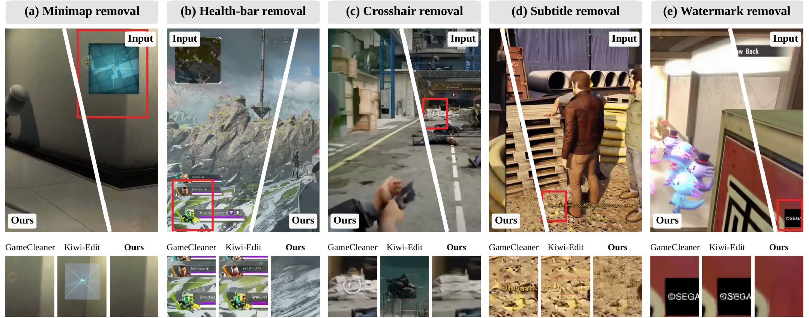
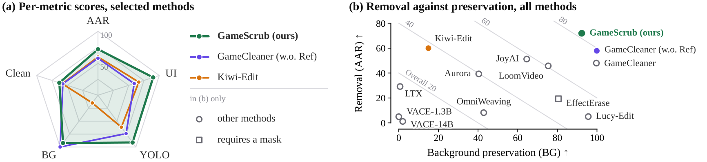

<div align="center">

# GameScrub

### Learning HUD Removal from Real Gameplay with Recovered Targets

[](https://areeb2735.github.io/gamescrub/)
[](https://huggingface.co/mohammadareebqazi/GameScrub)
[](https://huggingface.co/Lightricks/LTX-2.5)
[](LICENSE)

**Mask-free HUD removal for real gameplay video.** Give GameScrub a gameplay clip, and it
returns the same clip with the minimap, health bar, crosshair, subtitles, markers and
watermarks removed. No masks, no boxes, no prompts.



<sub>Each panel splits the frame diagonally: input with HUD on one side, GameScrub output on
the other. Bottom row: zoom on the HUD region for GameCleaner, Kiwi-Edit and GameScrub.</sub>

</div>

---

## ✨ Highlights

- 🎮 **No masks needed.** The model finds the HUD by itself: static panels, floating world
  markers, notices that come and go, subtitles, crosshairs.
- 🖼️ **Background preserved.** It removes the HUD and leaves the rest of the frame alone
  (95.3% background preservation on our benchmark).
- 🎞️ **Any length.** 145-frame clips by default. Longer videos run in blended windows on
  one GPU, or in a single pass across 8 GPUs.
- 🧪 **Trained on real gameplay.** The training targets are recovered from real recordings
  by a box-guided data pipeline, which is also released here.

## 📊 Results

<p align="center">
  
</p>

<sub>(a) Per-metric scores for GameScrub, GameCleaner (w/o ref) and Kiwi-Edit. (b) HUD
removal (AAR) against background preservation for all methods. GameScrub is top right.</sub>

200-clip benchmark: 100 synthetic clips (HUD rendered onto clean footage) and 100
in-the-wild clips (real gameplay with real HUD).

| Metric | Overall | Synthetic | Wild |
|:---|:---:|:---:|:---:|
| HUD removal (%) ↑ | **92.0** | 93.9 | 90.1 |
| Artifact-adjusted removal (%) ↑ | **77.1** | 82.2 | 72.0 |
| Background preservation (%) ↑ | **95.3** | 98.3 | 92.3 |
| Background LPIPS ↓ | **0.140** | 0.132 | 0.148 |
| Background MAE (0-255) ↓ | **5.57** | 5.47 | 5.66 |
| HUD detector reduction (%) ↑ | **94.3** | 97.3 | 91.2 |

On one A100 80GB, a 5 s clip (1280x704, 145 frames) takes about **81 s**, plus a one-time
model load of about 5 min. More videos and side-by-side comparisons are on the
**[project page](https://areeb2735.github.io/gamescrub/)**. Metric definitions:
[`Gamescrub_model/docs/RESULTS.md`](Gamescrub_model/docs/RESULTS.md).

## 📦 What's in this repository

| | Folder | What it does | Input → Output |
|:---:|---|---|---|
| 🧠 | **[`Gamescrub_model/`](Gamescrub_model)** | **Inference.** The GameScrub IC-LoRA on LTX-2.5 22B. Removes the HUD from any gameplay video. | clip → clean clip (1280x704, 30 fps) |
| 🛠️ | **[`gamescrub_data/`](gamescrub_data)** | **Data pipeline.** Recovers clean targets from clips with known HUD boxes: ProPainter pre-fill and masked LTX-2.5 diffusion. | clip + boxes → clean clip (640x352) |

```
                     ┌──────────────────── gamescrub_data ─────────────────────┐
gameplay clip ──────►│ boxes → ProPainter pre-fill → caption → masked LTX-2.5  │──► (HUD clip, clean clip) pairs
+ HUD boxes          └─────────────────────────────────────────────────────────┘          │
                                                                                         ▼  training data
                     ┌──────────────────── Gamescrub_model ────────────────────┐
any gameplay clip ──►│ LTX-2.5 22B distilled + GameScrub IC-LoRA (2 stages)    │──► clean clip
                     └─────────────────────────────────────────────────────────┘
```

**Which one do I need?**
- To remove the HUD from your videos, use **[`Gamescrub_model/`](Gamescrub_model)**.
- To build paired training data, or to remove the HUD when you already have accurate HUD
  boxes, use **[`gamescrub_data/`](gamescrub_data)**.

Each folder is self-contained, with its own environment, settings and README. It includes
all the code it needs (pinned LTX-2 code in `third_party/`). Only the model weights are
downloaded separately.

## 🤗 Model weights

| Weights | Where | Used by |
|---|---|---|
| GameScrub LoRA (`gamescrub_lora.safetensors`, 1.3 GB) | [mohammadareebqazi/GameScrub](https://huggingface.co/mohammadareebqazi/GameScrub) | `Gamescrub_model` |
| LTX-2.5 transformer, text encoder, VAEs, upsampler (~71 GB) | [Lightricks/LTX-2.5](https://huggingface.co/Lightricks/LTX-2.5) (gated: accept the terms on the page first) | both |
| ProPainter, RAFT, flow completion (0.2 GB) | [sczhou/ProPainter v0.1.0](https://github.com/sczhou/ProPainter/releases/tag/v0.1.0) | `gamescrub_data` |

The exact files and download commands are in each folder's README.

## 🚀 Quick start

**Requirements:** Linux x86_64, an NVIDIA GPU with **80 GB** (A100 80GB or H100), a driver
that supports CUDA 13.2, and [`uv`](https://docs.astral.sh/uv/). Set up each folder from
inside it, in its own environment.

<details open>
<summary><b>🧠 Remove the HUD from a video</b> (<code>Gamescrub_model</code>)</summary>

```bash
cd Gamescrub_model
uv venv --python 3.10 .venv && source .venv/bin/activate
uv pip install --no-deps --index-strategy unsafe-best-match -r requirements.txt
# download the weights (README, step 2), then:
cp .env.example .env            # fill in the checkpoint paths
set -a; source .env; set +a
python scripts/check_setup.py
bash scripts/run_one_video.sh clip.mp4 out/
```

Folders of clips, long videos and multi-GPU runs: [`Gamescrub_model/README.md`](Gamescrub_model/README.md).

</details>

<details>
<summary><b>🛠️ Recover a clean clip from HUD boxes</b> (<code>gamescrub_data</code>)</summary>

```bash
cd gamescrub_data
uv venv --python 3.10 .venv && source .venv/bin/activate
uv pip install --no-deps --index-strategy unsafe-best-match -r requirements.txt
uv venv --python 3.8 propainter-env
uv pip install --python propainter-env/bin/python -r requirements-propainter.txt
# download the weights (README, step 3), then:
cp .env.example .env            # checkpoint paths, PROPAINTER_PYTHON, API key, caption model
set -a; source .env; set +a
python scripts/check_setup.py
python scripts/run_pipeline.py --clip clip.mp4 --bboxes bboxes.json --out-dir out/clip --gpu 0
```

Batch runs, the box format and all settings: [`gamescrub_data/README.md`](gamescrub_data/README.md).

</details>

> [!NOTE]
> Frames are read in order with no frame-rate conversion, and output is written at 30 fps.
> Convert other frame rates first (`ffmpeg -i in.mp4 -r 30 out.mp4`). Outputs have no audio.

## 🔍 How it works

<details>
<summary><b>GameScrub model</b></summary>

- An **IC-LoRA** (in-context LoRA) on LTX-2.5 22B distilled. The HUD clip is VAE-encoded
  and appended to the sequence as a reference, and the model generates the clean version
  under a fixed prompt.
- **Two stages:** 8 denoising steps at 640x352, a x2 latent upsample, then 3 refinement
  steps at 1280x704. Unlike the stock LTX-2 IC-LoRA pipeline, the LoRA and the reference
  are also kept in stage 2, which is what preserves the background.
- **Long videos:** either 145-frame windows with 25-frame blended overlap on one GPU, or
  the whole video as one sequence split across 8 GPUs (sequence parallelism).

Details: [`Gamescrub_model/docs/HOW_IT_WORKS.md`](Gamescrub_model/docs/HOW_IT_WORKS.md).

</details>

<details>
<summary><b>Data pipeline</b></summary>

1. **Mask prep:** resize the clip to 640x352, trim or pad it to 145 frames, and draw the
   HUD boxes into a mask.
2. **ProPainter:** flow-guided video inpainting pre-fills the boxed regions with
   background borrowed from other frames.
3. **Caption:** a vision LLM (any OpenAI-compatible API) describes the clip with the HUD
   blacked out, without mentioning the HUD.
4. **Masked diffusion:** the base LTX-2.5 model (no LoRA) starts from the ProPainter result
   and regenerates only the latent cells under the boxes, guided by the caption. The
   result is pasted back onto the original clip, so everything outside the repainted area
   is kept.

Details: [`gamescrub_data/README.md`](gamescrub_data/README.md).

</details>

<details>
<summary><b>Differences between the two folders</b></summary>

Set up the two folders separately. Do not share an environment or `.env` file between them.

| | `gamescrub_data` | `Gamescrub_model` |
|---|---|---|
| Bundled LTX-2 code | commit `e98f6d9` | commit `c1b4675` |
| Video VAE | `ltx-2.5-video-vae-conv-bf16.safetensors` | `ltx-2.5-video-vae-bf16.safetensors` |
| LoRA | none (base model) | `gamescrub_lora.safetensors` |
| Env variable names | `LTX25_*`, `PROPAINTER_*`, `OPENAI_*`, `HUD_CAPTION_*` | `GAMESCRUB_*` |
| Extra environment | Python 3.8 for ProPainter | optional `ltx-kernels` build for multi-GPU |
| Resizing | stretched to 640x352 | aspect kept, center-cropped to 1280x704 |
| Length | exactly 145 frames (trimmed or padded) | 145 by default; any 8k+1 length with windows or multi-GPU |

The transformer, text encoder, audio VAE and spatial upsampler are the same files in both
folders, so you can download them once and point both `.env` files at them.

</details>

## 🗂️ Repository layout

```
.
├── README.md
├── LICENSE
├── figures/                      README figures (PDF originals + rendered images)
├── Gamescrub_model/              model inference (clip → clean clip)
│   ├── inference/                generate.py, generate_long_multigpu.py, decode_latents.py
│   ├── scripts/                  shell wrappers, check_setup.py, helpers
│   ├── docs/                     HOW_IT_WORKS.md, RESULTS.md
│   └── third_party/              LTX-2 (c1b4675), ltx-kernels
└── gamescrub_data/               data pipeline (clip + boxes → clean clip)
    ├── src/hud_removal/          the four stages
    ├── scripts/                  run_pipeline.py, run_pipeline_batch.py, check_setup.py
    ├── docs/bboxes_schema.md     input box format
    └── third_party/              LTX-2 (e98f6d9), ProPainter (3267825)
```

## 📜 License

The original GameScrub code is released under the **[MIT License](LICENSE)**. That covers
everything outside the `third_party/` folders. The bundled third-party code keeps its own
licenses:

- **LTX-2 code and LTX-2.5 weights** (`*/third_party/ltx2/`): LTX Community License,
  including the use restrictions in Section 4 and Attachment A of `LICENSE-2_x`. The
  GameScrub LoRA is a derivative of LTX-2.5 and is subject to the same license.
- **ProPainter** (`gamescrub_data/third_party/propainter/`): S-Lab License 1.0,
  **non-commercial use only**. The data pipeline as a whole is therefore limited to
  non-commercial use.
- **ltx-kernels** (`Gamescrub_model/third_party/ltx-kernels/`): Apache-2.0.

See the `NOTICE.md` files in each `third_party/` folder for exact sources and commits.

## 🙏 Acknowledgements

GameScrub builds on [LTX-2](https://github.com/Lightricks/LTX-2) by Lightricks,
[ProPainter](https://github.com/sczhou/ProPainter) by Shangchen Zhou et al., and
[RAFT](https://github.com/princeton-vl/RAFT) optical flow.
